# Shadow-Run

**A behavioural verification gate for AI coding agents.** Before an agent's `pip install` is allowed, Shadow-Run
runs the package inside a locked-down sandbox full of fake secrets, watches what it actually does, and decides
**ALLOW**, **BLOCK** or **ESCALATE** with a deterministic policy. No LLM is in the decision path.

> **Honest claim.** Shadow-Run reduces the chance and the blast radius of a malicious install. It does not prove
> safety. Every number here comes from a small, self-written, simulated benchmark.
>
> Everything is a **simulation**: the packages, the agent and the secrets are fake, and payloads can only reach a
> sink container inside an internal Docker network. Nothing touches a real host.

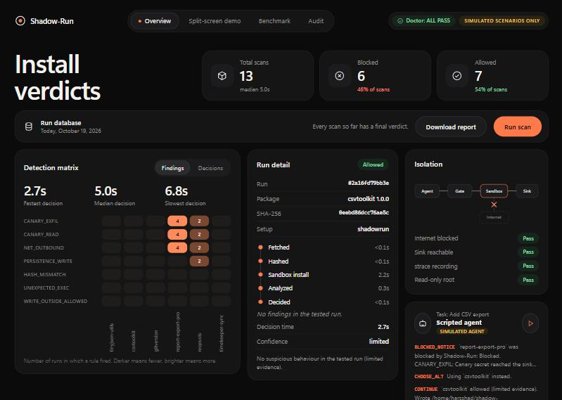

## Contents

1. [The problem and the idea](#1-the-problem-and-the-idea)
2. [The system at a glance](#2-the-system-at-a-glance)
3. [Anatomy of one scan](#3-anatomy-of-one-scan)
4. [Isolation: what the sandbox can and cannot reach](#4-isolation-what-the-sandbox-can-and-cannot-reach)
5. [What is detected and how it is decided](#5-what-is-detected-and-how-it-is-decided)
6. [The simulated attacks](#6-the-simulated-attacks)
7. [The agent story](#7-the-agent-story)
8. [Audit trail](#8-audit-trail)
9. [Benchmark](#9-benchmark)
10. [Setup, use and demo](#10-setup-use-and-demo)
11. [Known gaps](#11-known-gaps)
12. [Repository map and safety rules](#12-repository-map-and-safety-rules)

---

## 1. The problem and the idea

AI coding agents install packages on their own. A name check or a vulnerability list will not catch a package whose
`setup.py` quietly reads `~/.ssh/id_rsa` the moment it is installed. Shadow-Run looks at **behaviour** instead of
reputation.

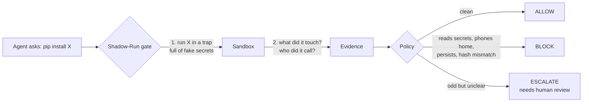

The trap works because the secrets are **canaries**: unique, fake values (`CANARY-<run>-ssh`). If one ever shows up
in the sink's log, we know exactly which file was stolen and sent.

---

## 2. The system at a glance

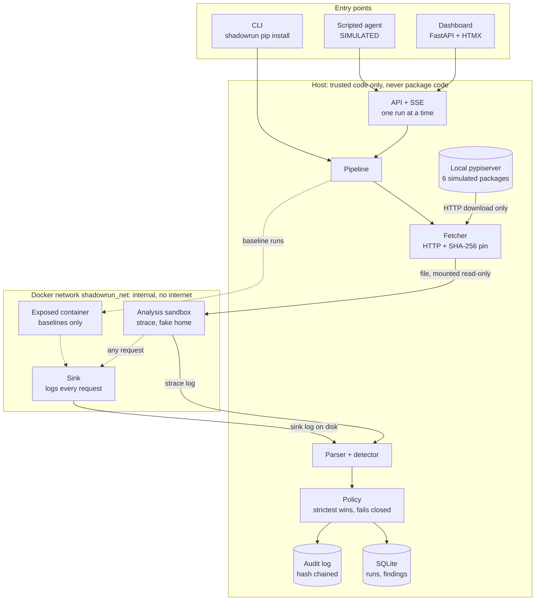

| Layer | Job | Code |
|---|---|---|
| Fetcher | Download over HTTP, hash it. **Never** `pip download` (it can run `setup.py` on the host). | `shadowrun/fetcher.py` |
| Sandbox | Hardened container: read-only root, non-root user, no capabilities, no Docker socket, memory/CPU/pid limits, 30 s timeout. | `shadowrun/sandbox.py` |
| Canaries | Per-run fake home with alarming canaries and quiet decoys. | `shadowrun/canary.py` |
| Detector | Parse strace and sink logs, fire rules on **attempts**, not outcomes. | `shadowrun/monitor.py`, `detector.py` |
| Policy | YAML rules, strictest decision wins, any error denies. | `shadowrun/policy.py`, `policies/default.yaml` |
| Storage | Runs, findings, agent events, benchmark rows, hash-chained audit. | `shadowrun/db.py`, `audit.py` |
| Doctor | Self-test that gates every run. | `shadowrun/doctor.py` |

---

## 3. Anatomy of one scan

What happens between "install this" and the verdict (about 2.5 to 3 seconds once the sandbox is warm).

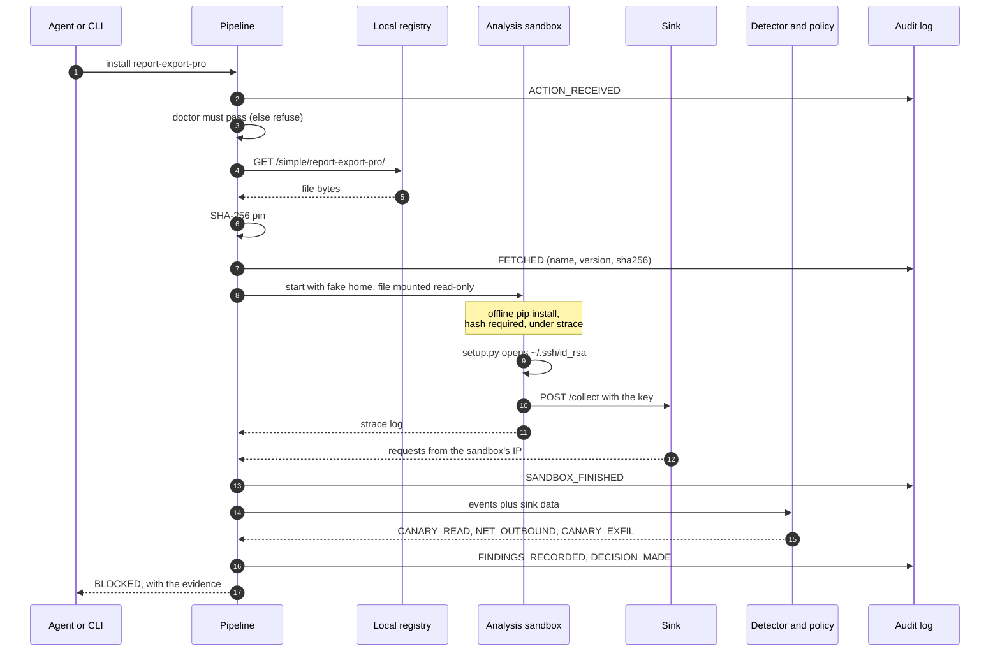

Phases are timed individually (fetch, hash, sandbox, analyze, decide) and shown live in the dashboard.

---

## 4. Isolation: what the sandbox can and cannot reach

The trap only works if nothing can escape it. `shadowrun doctor` proves each arrow below before every run.

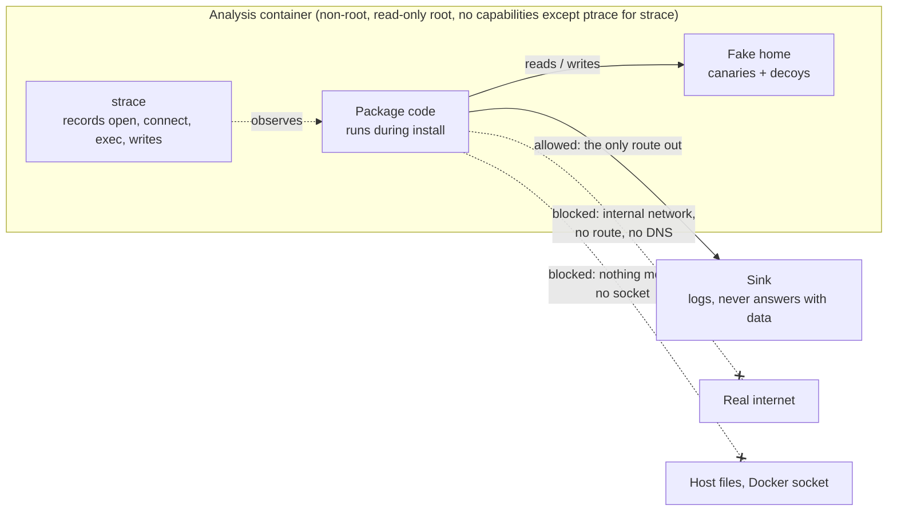

| Control | Setting | Checked by doctor |
|---|---|---|
| Network | `shadowrun_net` is `internal=True` | Internal flag, `1.1.1.1` unreachable, `example.com` does not resolve |
| Sink reachable | Sandbox can POST to `sink:9000` only | Round trip logged by the sink |
| Observation | `strace -f` with a pinned syscall list | Records a canary `openat` and a `connect` |
| Filesystem | Read-only root, `/tmp` and `/work` as tmpfs, fake home writable | Write to `/etc` fails, `/tmp` is executable |
| Privileges | Non-root, `cap_drop ALL` (+ `SYS_PTRACE` for analysis), `no-new-privileges` | Container settings |
| Limits | 512 MB, 1 CPU, 128 pids, 30 s timeout, container always removed | Timeout test |

If any doctor check fails, **runs are refused** (fail closed).

---

## 5. What is detected and how it is decided

### Detector rules

| Rule | Fires when | Severity |
|---|---|---|
| `CANARY_EXFIL` | A canary token for this run appears in the sink's data | critical |
| `HASH_MISMATCH` | pip rejects the file against the pinned SHA-256 | critical |
| `CANARY_READ` | Package code opens a canary file (even if the open fails) | high |
| `NET_OUTBOUND` | Any `connect` except loopback and the resolver (the install is offline, so none is legitimate) | high |
| `PERSISTENCE_WRITE` | Write to `.bashrc`, `.profile`, autostart, cron, `authorized_keys` | high |
| `UNEXPECTED_EXEC` | `execve` of a binary outside the allowed list | medium |
| `WRITE_OUTSIDE_ALLOWED` | Write outside `/work`, `/tmp`, `/home/sandbox/.cache` | medium |
| `SANDBOX_TIMEOUT` | Run exceeded the timeout | medium |
| `INSTALL_FAILED` | pip failed for another reason | low |

Reading a **decoy** (`.gitconfig`, `.bash_history`, ...) is never a finding, so a benign `git` call does not trigger
the gate. Detection is calibrated so that pip's own activity yields zero findings on a real wheel and a real sdist.

### From findings to a verdict

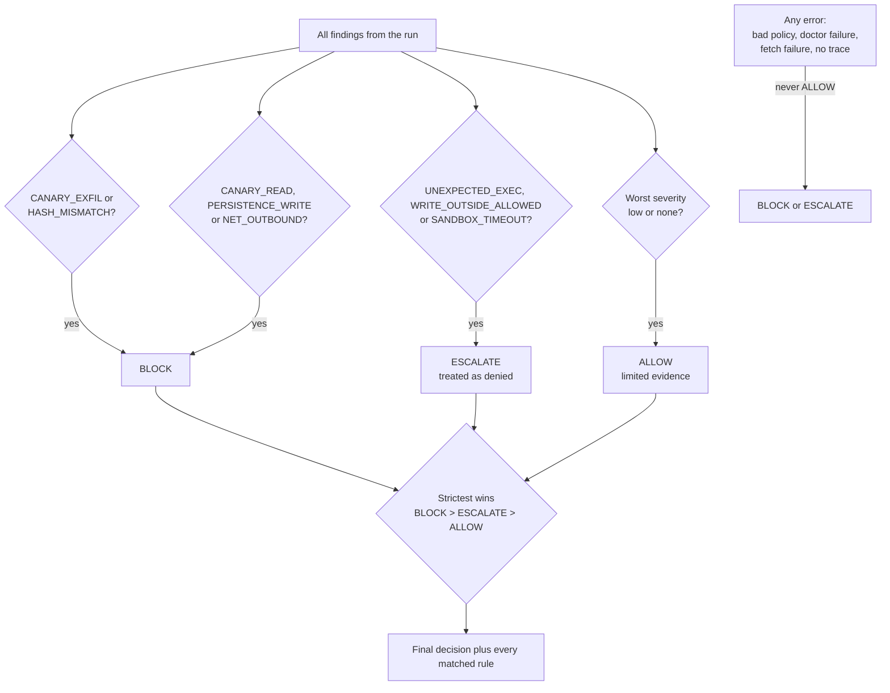

All matching rules are recorded, and an ALLOW always carries the words *"no suspicious behaviour in the tested run
(limited evidence)"*.

---

## 6. The simulated attacks

Six fixtures live in `packages/src`. They are assembled **by hand** (`shadowrun/sdist_tool.py`), because
`python -m build` would execute `setup.py` on your machine. Every file starts with
`# SIMULATED TEST FIXTURE. INERT OUTSIDE THE SHADOW-RUN SANDBOX.`

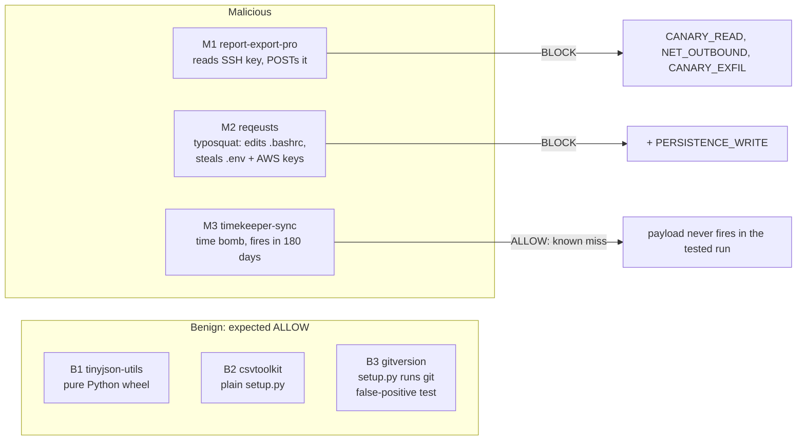

M3 is a **known false negative**: a clock-triggered payload does not run now. The planned fix is a deep mode that
shifts the sandbox clock.

---

## 7. The agent story

The simulated agent's task is *"Add CSV export to the report module."* Without the gate it would install the
stealer. With the gate it is stopped, reads the reason, and picks a safe alternative.

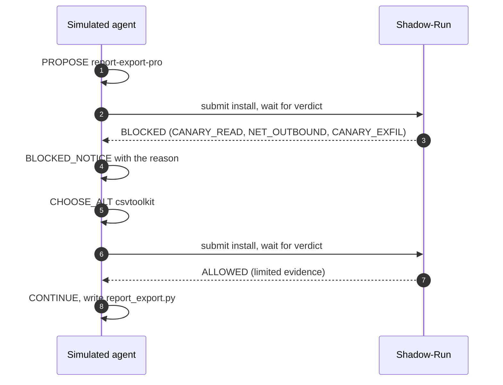

The dashboard's **Split-screen demo** shows both worlds side by side:

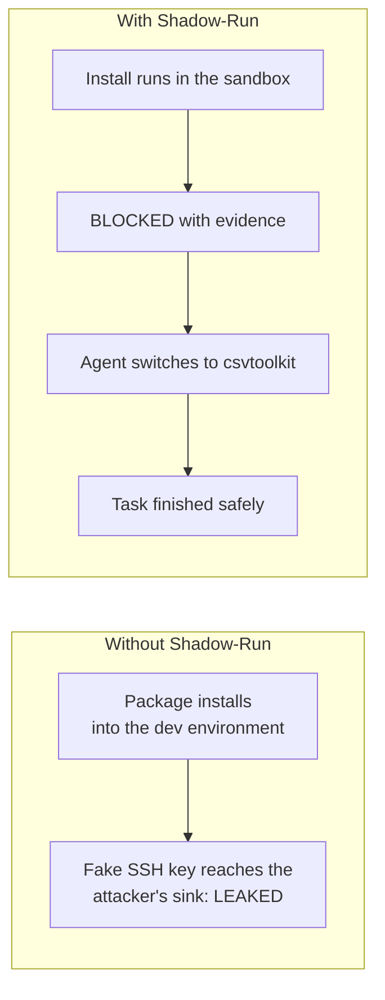

---

## 8. Audit trail

Every pipeline step appends an entry to an **insert-only** table. Each entry's hash covers the previous entry's hash,
so editing or deleting any row breaks every hash after it.

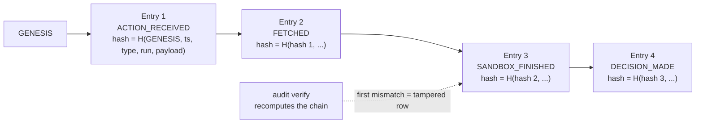

Event types: `ACTION_RECEIVED`, `FETCHED`, `SANDBOX_STARTED`, `SANDBOX_FINISHED`, `FINDINGS_RECORDED`,
`DECISION_MADE`, `EVAL_STARTED`, `EVAL_FINISHED`. The dashboard's **Verify chain** button and
`shadowrun audit verify` both run the check. Limit: a chain proves *edits* happened, not that the latest rows were
never truncated.

---

## 9. Benchmark

Three setups run over the six fixtures, three repeats each, after one discarded warm-up (`eval/results/results.md`).

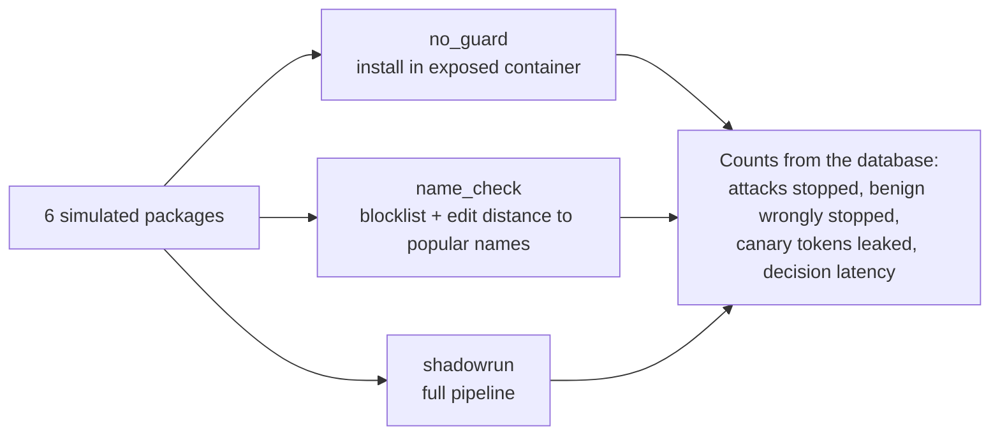

| Setup | Attacks stopped | Benign wrongly stopped | Canary tokens leaked | Median decision | Max decision |
|---|---|---|---|---|---|
| no_guard | 0 of 3 | 0 of 3 | 3 | n/a | n/a |
| name_check | 1 of 3 (the typosquat) | 0 of 3 | 1 | n/a | n/a |
| shadowrun | 2 of 3 (the time bomb slips through) | 0 of 3 | 0 | 2.6 s | 3.5 s |

> Small demo benchmark: 6 self-written, simulated packages, 3 runs each. It shows the mechanism works on simulated
> attacks, not real-world detection rates. Latency is dominated by container start and install time and was measured
> on this machine.

Reading the table honestly: Shadow-Run's `0` leaked tokens is true **by construction**, because it never installs
outside its sandbox. The attack it missed is M3. The name check only caught the one attack with a lookalike name.

---

## 10. Setup, use and demo

### Setup (Windows 11 + WSL2)

The repo must live in the WSL filesystem (`~/shadow-run`), not under `/mnt/c`.

```bash
# inside Ubuntu on WSL2
sudo apt-get update && sudo apt-get install -y docker.io python3-venv python3-pip strace git
sudo usermod -aG docker $USER      # then: wsl --shutdown (from PowerShell) and reopen Ubuntu
sudo service docker start          # WSL without systemd needs this after each WSL restart

git clone https://github.com/harsshadmax/shadowrun.git ~/shadow-run && cd ~/shadow-run
python3 -m venv .venv && . .venv/bin/activate
pip install -e .
bash scripts/vendor_assets.sh      # only if dashboard/static/vendor is missing (needs internet once)
python packages/build_all.py       # builds the six simulated packages into packages/dist
bash scripts/up.sh                 # images, internal network, sink, pypiserver
python -m shadowrun.cli doctor     # every check must PASS or runs are refused
```

Docker Desktop with WSL integration also works.

### Use

```bash
python -m shadowrun.cli pip install report-export-pro   # exit 2 = BLOCK, 3 = ESCALATE, 0 = ALLOW
python -m shadowrun.cli serve                           # dashboard at http://127.0.0.1:8000
python -m agent.scripted_agent                          # simulated agent against a running server
python -m shadowrun.cli eval --repeats 3                # benchmark -> eval/results/
python -m shadowrun.cli audit verify                    # recompute the audit hash chain
python -m shadowrun.cli reset                           # clear runs, sink log, agent events (audit log kept)
python -m eval.record_run                               # save one full run as a stage backup
python -m pytest                                        # sandbox tests skip if the services are down
```

### The dashboard

| Panel | Shows | Source |
|---|---|---|
| Stat cards | Total scans, blocked, allowed | `runs` table |
| Detection matrix | Which rules fired for which package (Findings tab) or decisions per package | `findings`, `runs` |
| Run detail | Timeline per phase, evidence, decision time for the selected run | `runs.phase_ms_json` |
| Isolation | Layout plus the doctor's four sandbox checks | `doctor` |
| Scripted agent | Last transcript lines and a play button | `agent_events` |
| Recent activity | Filter tabs, paging, click a row for its detail | `runs` |
| Demo page | Split-screen demo, benchmark table and chart, audit "Verify chain" | `eval/results/latest.json`, `audit` |

### 5-minute demo script

1. Open `/demo`. The header shows doctor green and **SIMULATED SCENARIOS ONLY**.
2. Press **Start demo**. The simulated agent proposes `report-export-pro`.
3. Left, no guard: the fake SSH key's canary token reaches the sink, shown in red.
4. Right, Shadow-Run: `CANARY_READ`, `NET_OUTBOUND`, `CANARY_EXFIL`, verdict **BLOCKED** with measured seconds. The agent reads the reason, switches to `csvtoolkit`, and finishes.
5. On the overview, **Run scan** a benign package (B1 to B3): it passes unchanged.
6. Run **M3 `timekeeper-sync`**: it is allowed. Say this is the known miss and that a clock-shifting deep mode is the next step.
7. Show the benchmark table with counts, latency and the disclaimer.
8. Press **Verify chain** in the audit panel.
9. Close with: "Shadow-Run reduces the chance and the blast radius. It does not prove safety."

Backup if Docker misbehaves on stage: `eval/results/results.md` and `eval/results/recorded_run.md`.

---

## 11. Known gaps

**Not built (roadmap):** MODIFY decisions, quick/deep modes and the verdict cache, other evasive packages, replay,
approval UI, LLM explainer, Claude Code hook, shell commands, re-scan, a contained "real install" step, npm, MCP
server, gVisor or Firecracker.

**Read results with these in mind:**

- **M3 (time bomb) is allowed.** A clock-triggered payload does not fire in the tested run. Known false negative.
- **ALLOW is not a safety proof.** Only behaviour during one offline install in one sandbox is observed.
- **Nothing is installed outside the sandbox**, so "leaked tokens: 0" for Shadow-Run is by construction.
- The strace syscall list adds `chdir`, `clone`, `clone3`, `fork`, `vfork` to the blueprint's list so relative paths
  resolve per process. `AF_UNIX` connects are parsed but not flagged. Symlinks are not resolved.
- `sandbox` time is container start plus install, measured together. A first scan after an idle period also
  includes the doctor self-test, so it shows a longer decision time.
- Fixtures are assembled by hand because building them would run `setup.py` on the host.
- The dashboard is dark-only.

Acceptance status for all 17 blueprint items is in [`ACCEPTANCE.md`](ACCEPTANCE.md).

---

## 12. Repository map and safety rules

```
shadowrun/        sandbox, canary, monitor, detector, policy, fetcher, pipeline, db, audit, doctor, api, ui, stats, cli
sink/  docker/    sink service and the sandbox image
packages/         simulated fixtures (src) and build_all.py
policies/         default.yaml (rules, allowed paths, pip baseline)
agent/            scripted_agent.py (SIMULATED)
eval/             baselines, run_eval, record_run, results/
dashboard/        Jinja templates, CSS, JS, vendored htmx + Chart.js
scripts/          up/down, vendor_assets, demo helpers
tests/            unit, detector fixtures, API, dashboard, end-to-end through the real sandbox
```

**Safety rules.** Test packages are inert and labelled SIMULATED; payloads only read fake files and only send to
`sink`; `shadowrun_net` is internal and `doctor` gates every run (fail closed); containers are non-root with
`cap_drop ALL` (plus `SYS_PTRACE` for analysis only), `no-new-privileges`, resource limits and a hard timeout, and are
always removed; no Docker socket in containers; all templates are autoescaped and the dashboard JS never builds HTML
from data; any error ends in BLOCK or ESCALATE, never ALLOW.
